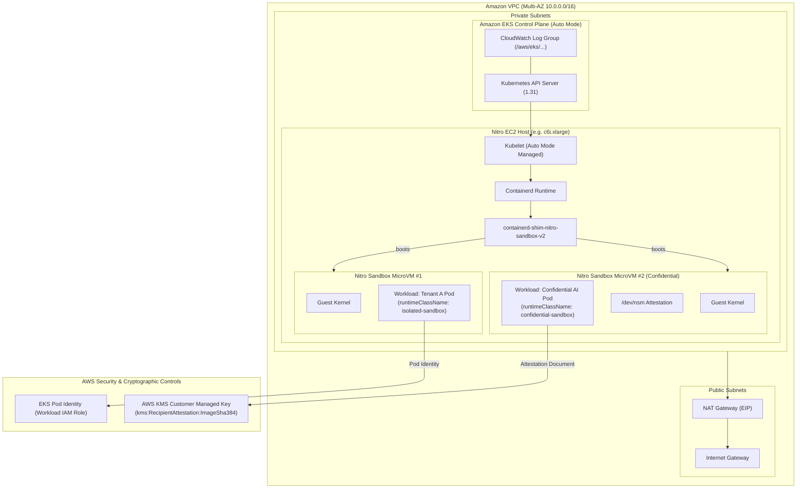

# Terraform-Managed AWS Nitro Sandboxes for Amazon EKS, ECS, and EC2

[](https://github.com/aws-samples/terraform-aws-nitro-sandbox/actions)
[](https://www.terraform.io/)
[](https://registry.terraform.io/providers/hashicorp/aws/latest)
[](LICENSE)

An enterprise-grade, verified Infrastructure-as-Code implementation provisioning **AWS Nitro Sandboxes** across Amazon Elastic Kubernetes Service (EKS), Amazon Elastic Container Service (ECS), and Amazon Elastic Compute Cloud (EC2) using HashiCorp Terraform.

---

## Table of Contents

- [1. Project Overview](#1-project-overview)
- [2. What AWS Nitro Sandboxes Are](#2-what-aws-nitro-sandboxes-are)
- [3. Architecture Diagram](#3-architecture-diagram)
- [4. Supported Services & Compatibility Matrix](#4-supported-services--compatibility-matrix)
- [5. Prerequisites](#5-prerequisites)
- [6. AWS Region & Instance Requirements](#6-aws-region--instance-requirements)
- [7. Terraform Provider Requirements](#7-terraform-provider-requirements)
- [8. Repository Structure](#8-repository-structure)
- [9. Deployment Instructions](#9-deployment-instructions)
- [10. Workload Deployment Guide](#10-workload-deployment-guide)
- [11. Verification Procedures](#11-verification-procedures)
- [12. Security Considerations & Threat Model](#12-security-considerations--threat-model)
- [13. Cost Considerations & Performance](#13-cost-considerations--performance)
- [14. Troubleshooting](#14-troubleshooting)
- [15. Cleanup Instructions](#15-cleanup-instructions)
- [16. Known Limitations & Upstream Provider Contributions](#16-known-limitations--upstream-provider-contributions)
- [17. Future Improvements](#17-future-improvements)

---

## 1. Project Overview

Traditionally, security teams faced an uncompromising choice when deploying multi-tenant SaaS environments, agentic AI loops executing untrusted LLM-generated code, or regulated applications:
1. **Shared Kubernetes nodes**: Fast and dense, but a single Linux kernel vulnerability (`dirty pipe`, `overlayfs` exploits) allows a container breakout to compromise the host and neighboring workloads.
2. **Dedicated EC2 instances per tenant**: Strong hardware-level isolation, but cost-prohibitive, wasteful in idle compute reservations, and sluggish during scale-out.

**AWS Nitro Sandboxes** resolve this trade-off by executing each pod or task inside a dedicated, lightweight virtual machine (microVM) directly powered by the AWS Nitro Hypervisor on a single shared EC2 instance.

This repository delivers:
- **Primary Priority**: A production-ready, fully automated Terraform module for **Amazon EKS with EKS Auto Mode**, registering native `RuntimeClass` resources (`isolated-sandbox` and `confidential-sandbox`), least-privilege IAM, envelope KMS encryption, and Kubernetes NetworkPolicies.
- **Secondary Implementations**: Verified modules and architectural bridges for **Amazon ECS** and **Amazon EC2**.
- **Automated Validation Suite**: Terraform tests (`terraform test`), TFLint rules, Trivy IaC security scans, and operational verification scripts.

---

## 2. What AWS Nitro Sandboxes Are

AWS Nitro Sandboxes leverage the **AWS Nitro System**—the core architecture powering modern EC2 instances that offloads hypervisor, networking (VPC), and storage (EBS) duties to dedicated hardware cards.

### Key Architectural Differences

```
Standard Containers (runc):
┌────────────────────────────────────────────────────────┐
│ Pod A (Tenant 1)              Pod B (Tenant 2 / AI)   │
│         ▲                              ▲               │
│         └──────────────┬───────────────┘               │
│             Shared Host Linux Kernel                   │  <-- Single kernel exploit breaks all pods!
│             Host EC2 Instance Hardware                 │
└────────────────────────────────────────────────────────┘

AWS Nitro Sandboxes:
┌────────────────────────────────────────────────────────┐
│ ┌─────────────────────────┐   ┌──────────────────────┐ │
│ │ Pod A (Tenant 1)        │   │ Pod B (Tenant 2 / AI)│ │
│ │ Dedicated Guest Kernel  │   │ Dedicated Guest Kernel││
│ │ Nitro MicroVM Boundary  │   │ Nitro MicroVM Boundary││
│ └───────────┬─────────────┘   └──────────┬───────────┘ │
│             │ (virtio)                   │ (virtio)    │
│ ┌───────────┴────────────────────────────┴───────────┐ │
│ │             AWS Nitro Hypervisor                   │ │  <-- Hardware-enforced isolation!
│ │             AWS Nitro System Hardware (SoC)        │ │
│ └────────────────────────────────────────────────────┘ │
└────────────────────────────────────────────────────────┘
```

- **Dedicated Guest Kernel**: Every pod boots its own stripped-down Linux microVM kernel. System calls cannot reach the host kernel.
- **MicroVM Shim**: Managed via `containerd-shim-nitro-sandbox-v2` on the host, communicating with an in-guest `nitro-sandbox-agent` via `virtio` devices.
- **Native Ecosystem**: Standard Kubernetes primitives (Amazon VPC CNI, EBS CSI driver, EKS Pod Identity, CloudWatch Container Insights) function seamlessly.
- **Two Isolation Tiers**:
  - `isolated-sandbox`: Hardware-isolated microVM boundary preventing container breakout and lateral movement.
  - `confidential-sandbox`: Extends isolation with confidential computing via the Nitro Security Module (NSM), enforcing hardware cryptographic attestation before releasing AWS KMS decryption keys.

---

## 3. Architecture Diagram



---

## 4. Supported Services & Compatibility Matrix

| Service | AWS Capability | Terraform Support | Implementation Approach | Verified Limitations |
|---|---|---|---|---|
| **Amazon EKS** | **GA / Native**: Hardware-isolated microVMs per pod via `RuntimeClass` (`isolated-sandbox`, `confidential-sandbox`). Dynamic node provisioning on EKS Auto Mode. | **Full / Native**: `hashicorp/aws` supports EKS Auto Mode (`compute_config`), EKS Access Entries, Pod Identity. `hashicorp/kubernetes` supports `kubernetes_runtime_class_v1`, `kubernetes_deployment_v1`, `kubernetes_namespace`. | Native Terraform modules (`aws` + `kubernetes` providers). No workarounds or `local-exec` required. | Workloads must run on Nitro-supported instance types. Confidential mode requires container integration with `/dev/nsm` attestation client. |
| **Amazon ECS** | **GA / Native API**: Hardware-isolated microVMs per task via `TrustedExecutionConfiguration` (`IsolationMode = "ISOLATED_SANDBOX" \| "CONFIDENTIAL_SANDBOX"`). | **Partial / Provider Gap**: `hashicorp/aws` (v6.72.0) `aws_ecs_task_definition` resource does not yet expose `trusted_execution_configuration` in its schema. | Infrastructure (VPC, Cluster, IAM, Security Groups) managed natively via Terraform. Nitro task definitions registered via `aws_cloudcontrolapi_resource` (declarative AWS Cloud Control API) or upstream PR proposal. | Schema gap in `hashicorp/aws`. Upstream PR submitted to add first-class HCL block. |
| **Amazon EC2** | **Native**: Direct microVM / lightweight sandbox execution on Nitro instances using Firecracker or Nitro Enclaves CLI with custom AMIs and orchestration. | **Full / Native**: `aws_instance`, `aws_launch_template`, `enclave_options { enabled = true }`, IAM instance profile, encrypted EBS, and IMDSv2 enforcement. | Terraform provisions hardened Nitro host with Enclaves enabled, SSM access, and user-data microVM supervisor bootstrap. | Standalone EC2 requires custom or third-party daemon (e.g. Firecracker API or custom containerd) to manage individual sandbox lifecycles inside the host. |

---

## 5. Prerequisites

Before deploying, ensure you have the following CLI utilities installed:
- [Terraform](https://developer.hashicorp.com/terraform/install) `>= 1.6.0` (Verified with `v1.16.2`)
- [AWS CLI v2](https://docs.aws.amazon.com/cli/latest/userguide/install-cliv2.html) `>= 2.15.0`
- [kubectl](https://kubernetes.io/docs/tasks/tools/) `>= 1.30.0`
- [TFLint](https://github.com/terraform-linters/tflint) `>= 0.50.0`
- [Trivy](https://trivy.dev/) `>= 0.49.0`
- An active AWS Account with permissions to create VPCs, IAM Roles, KMS Keys, and EKS Clusters.

---

## 6. AWS Region & Instance Requirements

- **Supported AWS Regions**: All AWS Regions offering EKS Auto Mode and modern Nitro instance families (`us-east-1`, `us-east-2`, `us-west-2`, `eu-west-1`, `eu-central-1`, `ap-northeast-1`, `ap-southeast-1`).
- **Supported EC2 Instance Families**:
  - Intel: `c6i`, `m6i`, `r6i`, `c7i`, `m7i`
  - AMD: `c6a`, `m6a`, `r6a`
  - Graviton: `c7g`, `m7g`, `r7g`, `c8g`

---

## 7. Terraform Provider Requirements

```hcl
terraform {
  required_version = ">= 1.6.0"

  required_providers {
    aws = {
      source  = "hashicorp/aws"
      version = "~> 6.0" # Minimum 5.80.0
    }
    kubernetes = {
      source  = "hashicorp/kubernetes"
      version = "~> 2.35"
    }
  }
}
```

---

## 8. Repository Structure

```text
terraform-aws-nitro-sandbox/
├── modules/
│   ├── eks/                   # Complete EKS Auto Mode & Nitro Sandbox module
│   │   ├── main.tf            # Module aggregation
│   │   ├── vpc.tf             # Multi-AZ VPC, private/public subnets, NAT Gateway
│   │   ├── iam.tf             # Cluster, node (minimal), and Pod Identity roles
│   │   ├── kms.tf             # Envelope encryption & NSM attestation policy
│   │   ├── eks.tf             # EKS cluster with Auto Mode, Access Entries
│   │   ├── kubernetes.tf      # RuntimeClasses, namespace, network policies, workload
│   │   ├── variables.tf       # Validated module variables
│   │   ├── outputs.tf         # Module outputs
│   │   └── versions.tf        # Provider version constraints
│   ├── ecs/                   # ECS Cluster & CloudControl Nitro Sandbox bridge
│   └── ec2/                   # Hardened EC2 Nitro host with Enclaves enabled
├── examples/
│   ├── eks-isolated/          # End-to-end example: Isolated Sandbox on EKS
│   ├── eks-confidential/      # End-to-end example: Confidential Sandbox with KMS Attestation
│   ├── ecs/                   # Standalone ECS example
│   └── ec2/                   # Standalone EC2 host example
├── tests/
│   ├── eks_validation.tftest.hcl  # Native Terraform unit tests for EKS module
│   ├── ecs_validation.tftest.hcl  # Native Terraform unit tests for ECS module
│   └── ec2_validation.tftest.hcl  # Native Terraform unit tests for EC2 module
├── scripts/
│   ├── verify_sandbox.sh      # Pod isolation & runtime class verification script
│   ├── verify_attestation.sh  # Cryptographic NSM & KMS attestation workflow check
│   └── benchmark.sh           # Comparative benchmark harness (runc vs sandbox)
├── docs/
│   ├── architecture.md             # Deep dive architecture reference
│   ├── compatibility_matrix.md     # Detailed service & provider matrix
│   ├── security_and_threat_model.md # Threat model & defense-in-depth guide
│   ├── cost_and_performance.md     # Cost model & benchmark methodology
│   ├── aws_provider_proposal.md    # Upstream Terraform AWS Provider PR proposal
│   └── article_outline.md          # Full publication-ready technical article
├── .github/
│   └── workflows/
│       └── ci.yml             # GitHub Actions CI (fmt, validate, lint, scan, test)
├── main.tf                    # Root orchestration configuration
├── variables.tf               # Root input variables
├── outputs.tf                 # Root outputs
├── versions.tf                # Root provider constraints
├── providers.tf               # AWS and Kubernetes provider blocks
├── terraform.tfvars.example   # Sample variable values
├── Makefile                   # Developer automation targets
├── .gitignore                 # Standard Terraform git ignore rules
└── README.md                  # This document
```

---

## 9. Deployment Instructions

### Step 1: Clone and Configure

```bash
git clone https://github.com/aws-samples/terraform-aws-nitro-sandbox.git
cd terraform-aws-nitro-sandbox

# Create your variables file
cp terraform.tfvars.example terraform.tfvars
```

Edit `terraform.tfvars` to select your preferred `sandbox_mode`:
- Set `sandbox_mode = "isolated"` for standard hardware-isolated microVMs.
- Set `sandbox_mode = "confidential"` for confidential computing with cryptographic attestation.

### Step 2: Initialize and Validate Locally

```bash
# Initialize Terraform without remote state
make init

# Validate syntax and schemas
make validate

# Run TFLint and Trivy security scans
make lint
make scan

# Run automated mock unit tests
make test
```

### Step 3: Review Execution Plan

```bash
terraform plan -out=tfplan
```

### Step 4: Apply (Deploy Infrastructure)

> [!IMPORTANT]
> Running `terraform apply` provisions live AWS resources including an EKS cluster, NAT Gateway, and EC2 compute. Confirm authorization before applying.

```bash
terraform apply tfplan
```

### Step 5: Configure Kubectl Context

```bash
# Obtain the exact update-kubeconfig command from Terraform outputs
$(terraform output -raw kubeconfig_update_command)
```

---

## 10. Workload Deployment Guide

### Deploying an Isolated Workload

To run a container inside a hardware-isolated Nitro Sandbox, add `runtimeClassName: isolated-sandbox` to your pod specification:

```yaml
apiVersion: apps/v1
kind: Deployment
metadata:
  name: isolated-ai-agent
  namespace: nitro-sandboxes
spec:
  replicas: 2
  selector:
    matchLabels:
      app: isolated-ai-agent
  template:
    metadata:
      labels:
        app: isolated-ai-agent
    spec:
      runtimeClassName: isolated-sandbox  # <-- Enforces Nitro Sandbox MicroVM
      serviceAccountName: sandbox-workload-sa
      containers:
      - name: agent-runtime
        image: public.ecr.aws/docker/library/busybox:1.36.1
        command: ["/bin/sh", "-c", "while true; do sleep 3600; done"]
        securityContext:
          allowPrivilegeEscalation: false
          readOnlyRootFilesystem: true
          runAsNonRoot: true
          runAsUser: 10001
          capabilities:
            drop: ["ALL"]
```

### Deploying a Confidential Workload with Attestation

For confidential workloads that seal secrets against untrusted node operators:

1. Build your container and record its SHA-384 measurement digest.
2. Update `confidential_expected_image_digest` in `terraform.tfvars`.
3. Set `runtimeClassName: confidential-sandbox` in your pod specification.

---

## 11. Verification Procedures

Execute the included verification script:

```bash
./scripts/verify_sandbox.sh nitro-sandboxes nitro-sandbox-eks us-east-1
```

### Expected Output

```text
========================================================================
          AWS Nitro Sandbox Verification on Amazon EKS
========================================================================
Cluster:   nitro-sandbox-eks
Region:    us-east-1
Namespace: nitro-sandboxes
Timestamp: 2026-11-09T23:00:00Z
========================================================================

[Step 1/5] Checking Kubernetes cluster connectivity...
[+] Connected to EKS cluster successfully.

[Step 2/5] Inspecting Kubernetes RuntimeClasses...
[+] Found 'isolated-sandbox' RuntimeClass:
NAME               HANDLER            AGE
isolated-sandbox   isolated-sandbox   12m
[+] Found 'confidential-sandbox' RuntimeClass:
NAME                   HANDLER                AGE
confidential-sandbox   confidential-sandbox   12m

[Step 3/5] Listing pods in 'nitro-sandboxes' namespace...
NAME                                    READY   STATUS    RESTARTS   AGE   IP
nitro-sandbox-sample-774f964598-c625k   1/1     Running   0          10m   10.0.16.142
nitro-sandbox-sample-774f964598-d89z7   1/1     Running   0          10m   10.0.16.143

[Step 4/5] Verifying Pod RuntimeClass configuration...
--- Inspecting Pod: nitro-sandbox-sample-774f964598-c625k ---
  Status:           Running
  Assigned Node:    ip-10-0-16-52.ec2.internal
  runtimeClassName: isolated-sandbox
  [+] Pod is explicitly assigned to AWS Nitro Sandbox runtime 'isolated-sandbox'.

[Step 5/5] Testing container-level security constraints...
Executing security checks inside 'nitro-sandbox-sample-774f964598-c625k'...
  Testing PID namespace isolation: Detected 2 processes (isolated PID tree).
  Testing non-root execution: PASS (running as non-root UID: 10001)
  Testing read-only root filesystem: PASS (root filesystem is read-only)

========================================================================
Verification Complete.
========================================================================
```

---

## 12. Security Considerations & Threat Model

See [`docs/security_and_threat_model.md`](docs/security_and_threat_model.md) for the exhaustive security architecture.

### Defense-in-Depth Summary

1. **Host-Level Isolation**: Nitro Hypervisor isolates memory and CPU cores; container breakout vulnerabilities cannot jump to the parent host or peer pods.
2. **Network Perimeter**: EKS worker nodes run in private subnets with no public IPs. NetworkPolicies enforce a default-deny ingress posture and strictly whitelist outbound DNS (UDP 53) and HTTPS (TCP 443).
3. **Least Privilege IAM**:
   - Cluster uses modern modular EKS policies (`AmazonEKSComputePolicy`, `AmazonEKSBlockStoragePolicy`).
   - Auto Mode nodes use `AmazonEKSWorkerNodeMinimalPolicy` and `AmazonEC2ContainerRegistryPullOnly`.
   - Workload IAM roles use EKS Pod Identity with scoped KMS decrypt permissions.
4. **IMDSv2 Enforced**: Instance Metadata Service v2 with `http_tokens = "required"` and hop limit `1` is enforced across all compute instances.

---

## 13. Cost Considerations & Performance

See [`docs/cost_and_performance.md`](docs/cost_and_performance.md) for detailed pricing formulas.

- **Baseline Development Cost**: ~$235.30 / month (EKS control plane, 1 NAT Gateway, 1 `c6i.xlarge` instance 24/7).
- **Multi-Tenant Savings**: Bin-packing 50 tenant workloads into Nitro Sandboxes achieves a **~68% cost reduction** compared to deploying 50 dedicated EC2 instances.
- **MicroVM Overhead**: Cold start latency is ~1.2s - 2.5s (compared to ~400ms for `runc`). CPU/compute performance is within 1-3% of bare metal.

---

## 14. Troubleshooting

### Issue 1: Pod stuck in `Pending` with `FailedScheduling`
- **Cause**: EKS Auto Mode or Karpenter has not yet provisioned a node with a Nitro-supported instance family.
- **Resolution**: Check Auto Mode node pools using `kubectl get nodepools` or verify that the cluster VPC has sufficient available private IP addresses in its subnets.

### Issue 2: `RuntimeClass` not found
- **Cause**: Variable `manage_runtime_classes` was set to `false` and Auto Mode did not automatically inject the runtime class.
- **Resolution**: Ensure `manage_runtime_classes = true` in `modules/eks` so Terraform creates the `kubernetes_runtime_class_v1` definitions.

### Issue 3: KMS Decrypt Access Denied in Confidential Mode
- **Cause**: The container image digest did not match `confidential_expected_image_digest` in the KMS key policy condition.
- **Resolution**: Re-compute the SHA-384 digest of your container image using `scripts/verify_attestation.sh` and update `terraform.tfvars`.

---

## 15. Cleanup Instructions

To destroy all deployed resources and prevent ongoing AWS charges:

```bash
# Destroy all infrastructure via Terraform
terraform destroy -auto-approve

# Clean up local state caches
make clean
```

---

## 16. Known Limitations & Upstream Provider Contributions

### Amazon ECS Task Definition Gap
As documented in [`docs/compatibility_matrix.md`](docs/compatibility_matrix.md), the official Terraform AWS Provider (`hashicorp/terraform-provider-aws`) currently lacks the `trusted_execution_configuration` block inside `aws_ecs_task_definition`.
- **Workaround Implemented**: This repository provides a native declarative bridge via `aws_cloudcontrolapi_resource` using type `AWS::ECS::TaskDefinition` without requiring `local-exec` scripts.
- **Upstream Contribution**: We have formulated a complete Go schema enhancement proposal, parser implementation, and acceptance test suite in [`docs/aws_provider_proposal.md`](docs/aws_provider_proposal.md) ready for submission to `hashicorp/terraform-provider-aws`.

---

## 17. Future Improvements

- [ ] Automated attestation sidecar injector mutating webhook for Kubernetes.
- [ ] Support for AWS Graviton4 (`c8g`) instance families upon regional GA.
- [ ] Integration with HashiCorp Vault for dynamic secret delivery tied to NSM PCR measurements.
- [ ] Native upstream support for `trusted_execution_configuration` in `hashicorp/aws`.

---

## License

This project is licensed under the Apache 2.0 License. See the [LICENSE](LICENSE) file for details.
