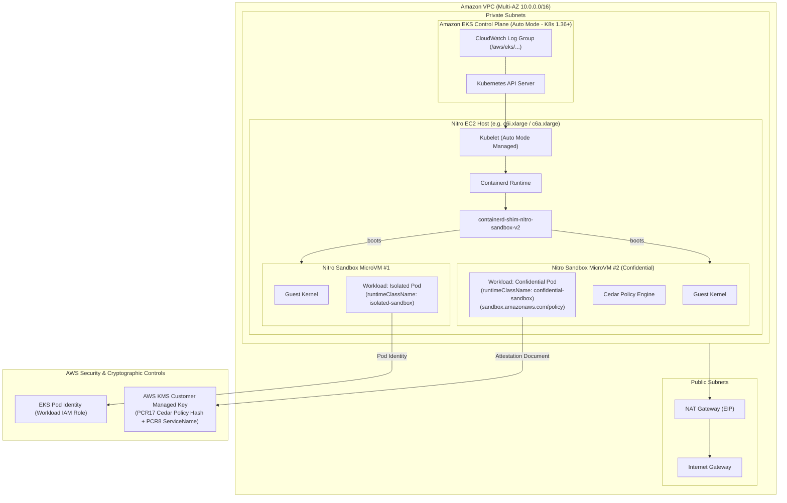

# Production-Ready AWS Nitro Sandboxes on Amazon EKS Auto Mode

[](https://github.com/Roslaan001/terraform-aws-eks-nitro-sandboxes/actions)
[](https://www.terraform.io/)
[](https://registry.terraform.io/providers/hashicorp/aws/latest)
[](LICENSE)

An enterprise-grade, verified Infrastructure-as-Code implementation provisioning **AWS Nitro Sandboxes** on **Amazon Elastic Kubernetes Service (Amazon EKS) with EKS Auto Mode** using HashiCorp Terraform.

---

## Table of Contents

- [1. Project Overview](#1-project-overview)
- [2. What AWS Nitro Sandboxes Are](#2-what-aws-nitro-sandboxes-are)
- [3. Architecture Diagram](#3-architecture-diagram)
- [4. Isolation Modes: Isolated vs Confidential](#4-isolation-modes-isolated-vs-confidential)
- [5. Cedar Policy & Attestation Workflow](#5-cedar-policy--attestation-workflow)
- [6. Prerequisites](#6-prerequisites)
- [7. AWS Region & Instance Requirements](#7-aws-region--instance-requirements)
- [8. Repository Structure](#8-repository-structure)
- [9. Deployment Instructions](#9-deployment-instructions)
- [10. Workload Deployment Guide](#10-workload-deployment-guide)
- [11. Verification Procedures](#11-verification-procedures)
- [12. Security Considerations & Threat Model](#12-security-considerations--threat-model)
- [13. Cost Considerations & Infrastructure Analysis](#13-cost-considerations--infrastructure-analysis)
- [14. Troubleshooting](#14-troubleshooting)
- [15. Cleanup Instructions](#15-cleanup-instructions)
- [16. License](#16-license)

---

## 1. Project Overview

Traditionally, security teams faced an uncompromising choice when deploying multi-tenant SaaS environments, agentic AI loops executing untrusted LLM-generated code, or regulated applications:
1. **Shared Kubernetes nodes**: Fast and dense, but a single Linux kernel vulnerability (`dirty pipe`, `overlayfs` exploits) allows a container breakout to compromise the host and neighboring workloads.
2. **Dedicated EC2 instances per tenant**: Strong hardware-level isolation, but cost-prohibitive, wasteful in idle compute reservations, and sluggish during scale-out.

Announced in November 2026 ([AWS What's New Announcement](https://aws.amazon.com/about-aws/whats-new/2026/11/nitro-sandboxes-eks-ecs-ec2/)), **AWS Nitro Sandboxes** resolve this trade-off by executing each pod inside an isolated lightweight virtual machine (microVM) directly powered by the AWS Nitro Hypervisor on a single shared EC2 instance at no extra compute charge beyond the underlying instance capacity.

This repository delivers:
- **Amazon EKS Auto Mode Infrastructure**: Clean Terraform implementation leveraging built-in `RuntimeClass` resources (`isolated-sandbox` and `confidential-sandbox`), least-privilege IAM, envelope KMS encryption with CloudWatch integration, and Kubernetes NetworkPolicies.
- **Hardware-Enforced Workload Isolation**: Ready-to-deploy isolated and confidential workloads featuring Cedar policy integration, and KMS key policies gated on PCR17/PCR8 attestation (used for decrypting encrypted container images inside the guest).
- **Your Applications**: A separate Terraform stack in `apps/` with one YAML file per app. Each app gets its own IAM role through EKS Pod Identity (and, for confidential apps, its own PCR17/PCR8-gated KMS statements). Terraform can deploy the app, or create only its identity so the team deploys with kubectl, Helm or GitOps.
- **Automated Validation Suite**: Native Terraform tests (`terraform test`), static validation, and operational verification scripts (`scripts/verify_sandbox.sh`).

---

## 2. What AWS Nitro Sandboxes Are

AWS Nitro Sandboxes leverage the **AWS Nitro System**—the core architecture powering modern EC2 instances that offloads hypervisor, networking (VPC), and storage (EBS) duties to dedicated hardware cards.

### Key Architectural Differences

```
Standard Containers (runc):
┌────────────────────────────────────────────────────────┐
│ Pod A (Tenant 1)              Pod B (Tenant 2 / AI)   │
│         ▲                              ▲               │
│         └──────────────┬───────────────┘               │
│             Shared Host Linux Kernel                   │  <-- Single kernel exploit breaks all pods!
│             Host EC2 Instance Hardware                 │
└────────────────────────────────────────────────────────┘

AWS Nitro Sandboxes:
┌────────────────────────────────────────────────────────┐
│ ┌─────────────────────────┐   ┌──────────────────────┐ │
│ │ Pod A (Tenant 1)        │   │ Pod B (Tenant 2 / AI)│ │
│ │ Per-Pod Guest Kernel    │   │ Per-Pod Guest Kernel │ │
│ │ Nitro MicroVM Boundary  │   │ Nitro MicroVM Boundary││
│ └───────────┬─────────────┘   └──────────┬───────────┘ │
│             │ (virtio)                   │ (virtio)    │
│ ┌───────────┴────────────────────────────┴───────────┐ │
│ │             AWS Nitro Hypervisor                   │ │  <-- Hardware-enforced isolation!
│ │             AWS Nitro System Hardware (SoC)        │ │
│ └────────────────────────────────────────────────────┘ │
└────────────────────────────────────────────────────────┘
```

- **Per-Pod Guest Kernel**: Every pod boots its own stripped-down Linux microVM kernel. System calls cannot reach the host kernel.
- **MicroVM Shim**: Managed via `containerd-shim-nitro-sandbox-v2` on the host, communicating with an in-guest agent via `virtio` devices.
- **Native Ecosystem**: Most standard Kubernetes primitives work unchanged, including EKS Pod Identity, EBS volumes (attached to the sandbox as raw block devices; use `ReadWriteOncePod`, and no online expansion) and the CloudWatch Observability agent. Some features are not supported, for example `hostNetwork` and GPU passthrough. See the [EKS sandbox limitations](https://docs.aws.amazon.com/eks/latest/userguide/sandboxing-limitations.html).
- **Built-in Auto Mode RuntimeClasses**:
  - `isolated-sandbox`: Hardware-isolated microVM boundary protecting the host and neighboring pods from container breakouts.
  - `confidential-sandbox`: Extends isolation with confidential computing, Cedar policy enforcement, encrypted overlay storage, and cryptographic attestation that KMS can require, for example before the guest agent decrypts an encrypted container image.

---

## 3. Architecture Diagram



---

## 4. Isolation Modes: Isolated vs Confidential

AWS Nitro Sandboxes provide two distinct isolation tiers on Amazon EKS:

| Dimension | `isolated-sandbox` | `confidential-sandbox` |
|---|---|---|
| **Primary Objective** | **Blast Radius Containment**: Prevent untrusted code from breaking out to the host or peer workloads. | **Zero-Trust Confidentiality**: Protect sensitive proprietary code, models, or data from host administrators and infrastructure. |
| **Trust Model** | Underlying EC2 host and node operators are trusted; running container code is untrusted. | Host operators, hypervisor admins, and neighboring pods are untrusted. Workload identity is cryptographically validated. |
| **Kernel Isolation** | Per-pod guest Linux kernel. | Per-pod guest Linux kernel. |
| **Memory Isolation** | Memory partitioned by the Nitro Hypervisor. | Memory partitioned by the Nitro Hypervisor; see the AWS Nitro Sandboxes documentation for confidential-mode memory protections. |
| **Policy Enforcement** | Standard Linux capabilities and container security context. | **Cedar Policy Engine**: Evaluated by the in-guest sandbox agent against the pod specification. |
| **Interactive Access (`exec` / `stdin`)** | Supported over vsock channel using standard Kubernetes RBAC. | Governed/restricted by the Cedar policy embedded at admission time. |
| **Cryptographic Attestation** | Not applicable. | **Mandatory**: Nitro Secure Module issues signed attestation containing PCR17 (Cedar policy hash) and PCR8 (`eks.amazonaws.com`). |
| **AWS KMS Access** | Standard IAM role permissions. | Key policy gated on `kms:RecipientAttestation:PCR17` and `kms:RecipientAttestation:PCR8:ServiceName`. Only the AWS agent in the guest can make attested calls (encrypted-image decryption); the app's own SDK `kms:Decrypt` / `kms:GenerateDataKey` calls are unattested and explicitly denied. |
| **Pod Container Sharing** | Containers inside the same pod share the same microVM. | Containers inside the same pod share the same microVM. |

---

## 5. Cedar Policy & Attestation Workflow

In **confidential mode**, workloads require a reproducible Cedar policy generated from the exact pod specification using `eks-nitro-sandbox-genpolicy`:

1. **Manifest Preparation**: The pod manifest specifies immutable container image digests (`image@sha256:...`), commands, environment variables, mounts, and security contexts.
2. **Policy Generation**:
   ```bash
   eks-nitro-sandbox-genpolicy --profile confidential --with-pod-identity pod-manifest.yaml
   ```
   `--with-pod-identity` is required when the pod uses EKS Pod Identity (the webhook injects the token volume after the manifest is read). genpolicy pins environment variables exactly, so set `enableServiceLinks: false` or pass `--allow-additional-env`.

   This outputs:
   - Base64-encoded Cedar policy string.
   - Predicted **PCR17** measurement hash.
3. **Pod Annotation**: The base64 string is attached to the pod template:
   ```yaml
   metadata:
     annotations:
       sandbox.amazonaws.com/policy: "<BASE64_CEDAR_POLICY>"
   spec:
     runtimeClassName: confidential-sandbox
   ```
4. **KMS Policy Binding** (`platform/kms.tf`): the key policy has three statements for the workload role on `kms:Decrypt` / `kms:GenerateDataKey`:
   - `DenyConfidentialWorkloadMismatchedPCR17`: Deny when `kms:RecipientAttestation:PCR17` is not the predicted value (`StringNotEqualsIgnoreCase`).
   - `DenyConfidentialWorkloadMismatchedPCR8`: Deny when `kms:RecipientAttestation:PCR8:ServiceName` is not `eks.amazonaws.com`.
   - `EnforceNitroAttestationForConfidentialWorkloads`: Allow only when both match (`StringEqualsIgnoreCase`).

   The explicit Denies are the critical controls. They override any Allow, including IAM policies delegated through the account-root statement. Because negated operators match when the key is absent, a request **without** an attestation document is also denied.

   ```json
   "Condition": {
     "StringEqualsIgnoreCase": {
       "kms:RecipientAttestation:PCR17": "<PREDICTED_PCR17_HASH>",
       "kms:RecipientAttestation:PCR8:ServiceName": "eks.amazonaws.com"
     }
   }
   ```

   Containers cannot open the Nitro Secure Module (`/dev/nsm`) themselves: the generated admission policy allows no devices. The supported in-guest attested decrypt is performed by the AWS sandbox agent, for example when unwrapping **encrypted container image layers**. The agent calls KMS `Decrypt` with a `Recipient` attestation document and unwraps `CiphertextForRecipient` inside the guest. See [`examples/attestation-e2e/`](examples/attestation-e2e/README.md).
5. **Regeneration Requirement**: If any aspect of the pod template changes (image digest, args, environment variables, mounts), the Cedar policy must be regenerated and the KMS PCR17 condition updated accordingly.

---

## 6. Prerequisites

- [Terraform](https://developer.hashicorp.com/terraform/install) `>= 1.6.0`
- [AWS CLI v2](https://docs.aws.amazon.com/cli/latest/userguide/install-cliv2.html) `>= 2.15.0`
- [kubectl](https://kubernetes.io/docs/tasks/tools/) `>= 1.30.0`
- Configured AWS credentials with permissions for VPC, IAM, KMS, and EKS.
- For confidential mode: `eks-nitro-sandbox-genpolicy`, from the signed [Nitro Sandboxes runtime binaries](https://docs.aws.amazon.com/eks/latest/userguide/sandboxing-download-binaries.html).
- For `scripts/verify_sandbox.sh`: `jq`, `python3`, `base64` and `gzip`.

---

## 7. AWS Region & Instance Requirements

- **Kubernetes Version**: Requires **Kubernetes 1.36 or later** for native AWS Nitro Sandboxes support on Amazon EKS.
- **Supported AWS Regions**: All commercial AWS Regions ([EKS sandboxing](https://docs.aws.amazon.com/eks/latest/userguide/sandboxing.html)).
- **Supported EC2 Instance Types**: Most Nitro-based Intel, AMD and Graviton families (for example `c6i`, `m6i`, `r6i`, `c6a`, `m6a`, `r6a`, `c7g`, `m7g`, `c8a`), but **not every size**. For example, `c6i.large`, `m6a.large`, `c7g.medium` and the `.metal` sizes are excluded, and flex instances (`c7i-flex`, `m7i-flex`, ...) are not supported. Check the [supported instance types](https://docs.aws.amazon.com/AWSEC2/latest/UserGuide/amazon-ec2-nitro-sandboxes.html#nitro-sandboxes-considerations). EKS Auto Mode provisions a compatible node automatically; the reference deployment received a `c8a.large`.

---

## 8. Repository Structure

```text
.
├── platform/                  # STACK 1: the platform (deploy once)
│   ├── vpc.tf                 # Multi-AZ VPC, private/public subnets, NAT Gateway, Flow Logs
│   ├── iam.tf                 # EKS Auto Mode cluster, node, and sample-workload Pod Identity roles
│   ├── kms.tf                 # Envelope encryption & PCR17/PCR8 attestation policy (sample workload)
│   ├── eks.tf                 # EKS cluster with Auto Mode compute, storage, and networking
│   ├── kubernetes.tf          # Namespace (restricted PSS), network policies, sample workloads, Service
│   ├── variables.tf           # Input variables (sandbox_modes list validated; default Kubernetes 1.36)
│   ├── outputs.tf             # Cluster endpoints, KMS ARNs, verify commands
│   ├── providers.tf           # AWS and Kubernetes provider configuration
│   ├── versions.tf            # Terraform >= 1.6; AWS ~> 6.0, Kubernetes ~> 2.35
│   ├── isolated.tfvars        # Preset: sandbox_modes = ["isolated"]
│   ├── confidential.tfvars    # Preset: ["isolated", "confidential"] with real PCR17 + Cedar policy
│   ├── terraform.tfvars.example  # Template; PCR17 and Cedar policy are placeholders you must replace
│   ├── backend.tf.example     # S3 remote state template
│   └── tests/eks_validation.tftest.hcl  # Mocked plan tests
├── apps/                      # STACK 2: your applications (one <name>.yaml per app)
│   ├── example.yaml.example   # Every field with its default
│   ├── hello-web.yaml         # Example app
│   ├── main.tf, variables.tf, outputs.tf  # Finds the platform by name; one module per app
│   ├── backend.tf.example     # S3 remote state template (separate key)
│   └── tests/                 # Mocked tests for the stack and the module
├── modules/sandbox-workload/  # Per-app IAM role, KMS key (confidential), Pod Identity, ServiceAccount, Deployment, Service, NetworkPolicy
├── scripts/verify_sandbox.sh  # Live verification of the platform (nine checks)
├── examples/attestation-e2e/  # Manual end-to-end KMS recipient-attestation test
├── .github/workflows/ci.yml   # fmt, validate, TFLint, Trivy and terraform test (both stacks)
├── Makefile                   # Automation targets (validate, test, plan; apps-*)
├── .gitignore                 # Standard Terraform ignore rules
└── README.md                  # Comprehensive architectural guide
```

---

## 9. Deployment Instructions

The platform is its own Terraform stack in `platform/`; run these steps there.

### Step 1: Select Configuration Preset

```bash
cd platform

# Option A: Deploy Isolated Sandboxes only
cp isolated.tfvars terraform.tfvars

# Option B: Deploy Isolated + Confidential side-by-side, with attestation
# (ready to use: PCR17 and Cedar policy match the default confidential image)
# cp confidential.tfvars terraform.tfvars

# Option C: Start from the annotated template
# cp terraform.tfvars.example terraform.tfvars
```

`terraform.tfvars.example` contains **placeholder** `confidential_expected_pcr17` and `confidential_cedar_policy_base64` values. Confidential pods will be rejected, and KMS will deny them, until you replace both with the output of `eks-nitro-sandbox-genpolicy` (see [§5](#5-cedar-policy--attestation-workflow)).

### Step 1b: Remote State (recommended for shared or production use)

By default, state is a local `terraform.tfstate` file in each stack (`platform/` and `apps/`). For a team or production, copy `platform/backend.tf.example` to `platform/backend.tf` (and `apps/backend.tf.example` to `apps/backend.tf`, with a different state key), set your S3 bucket, and run `terraform init -migrate-state` to move any existing state. It uses S3-native locking (`use_lockfile`, Terraform >= 1.10). Restrict `cluster_endpoint_public_access_cidrs` to your network as well; it defaults to `0.0.0.0/0`.

### Step 2: Initialize and Validate Locally

```bash
# In platform/
terraform init
terraform fmt -check -recursive
terraform validate
terraform test          # mocked; no AWS calls
```

### Step 3: Review Execution Plan

```bash
terraform plan -out=tfplan
```

### Step 4: Apply (Interactive Review)

```bash
terraform apply tfplan
```

### Step 5: Configure Kubectl Context

Run the explicit update-kubeconfig command:

```bash
aws eks update-kubeconfig --region us-east-1 --name nitro-sandbox-eks
```

---

## 10. Workload Deployment Guide

**Sample workloads.** With `deploy_sample_workload = true` (default), Terraform deploys `nitro-sandbox-isolated` and `nitro-sandbox-confidential` (label `app: nitro-sandbox-sample`, port 8080) behind the `nitro-sandbox-service` Service. They share the `sandbox-workload-sa` ServiceAccount and role, and are what `scripts/verify_sandbox.sh` checks. Set `deploy_sample_workload = false` once you run your own apps.

**Namespace rules for every pod:**
- The namespace enforces the **restricted** Pod Security Standard. Every container needs `runAsNonRoot`, `allowPrivilegeEscalation: false`, all capabilities dropped and `seccompProfile: RuntimeDefault`.
- NetworkPolicies are default-deny. Pods can only send DNS and HTTPS (443). Ingress is allowed only where a policy opens it: `allow_ingress` for apps, ports 80/8080 for the samples.

### Deploying Your Own Applications

Your apps live in a **separate Terraform stack** in `apps/`, with its own state. It finds the platform by name (cluster, namespace, platform KMS key) through data sources, so adding or changing an app **never touches the VPC, EKS, IAM or platform KMS key**, and plans only refresh the apps. Run all app commands from `apps/` (or with `make apps-plan`, or `terraform -chdir=apps ...`). Deploy the platform first.

Each application is **one YAML file** in `apps/`. The file name is the app name (lowercase letters, digits, hyphens). Every app gets its own **IAM role** (`<cluster>-<app>`, assumable only through EKS Pod Identity for this cluster), Pod Identity association and ServiceAccount, and optionally an ingress NetworkPolicy. Confidential apps also get their **own KMS key** (`alias/<cluster>-<app>`), usable only by that app's role with a matching PCR17 and PCR8, in practice by the AWS agent in the guest to decrypt the app's **encrypted container images**. The app's own SDK calls are unattested, so its `kms:Decrypt` / `kms:GenerateDataKey` on this key are explicitly denied; this key is not for runtime data; see "What attestation gates" below. Then choose who deploys the pods:

| | **Terraform deploys** (`manage_deployment: true`, default) | **You deploy with kubectl / Helm / GitOps** (`manage_deployment: false`) |
|---|---|---|
| Terraform creates | Role, Pod Identity, ServiceAccount, NetworkPolicy, **Deployment, Service** | Role, Pod Identity, ServiceAccount, NetworkPolicy (the "identity slot") |
| You provide | Just the YAML file | The YAML file, then your own Deployment/Service manifests |
| Best for | Simple apps, everything in one place | Teams with existing manifests, Helm charts or Argo CD/Flux |

`apps/example.yaml.example` lists every field with its default. Set `deploy_sample_workload = false` to remove the nginx samples. To use a different folder per environment, set `apps_dir`.

#### Option A: Terraform deploys the app

```yaml
# apps/my-api.yaml
mode: isolated
image: 123456789012.dkr.ecr.us-east-1.amazonaws.com/my-api:1.0.0
replicas: 2
port: 8080              # creates Service "my-api" on 8080
allow_ingress: true     # opens that port in the NetworkPolicy
env:
  LOG_LEVEL: info
iam_policy_arns:        # permissions for this app's own role
  - arn:aws:iam::123456789012:policy/my-api-s3
```

```bash
cd apps
terraform init                                                 # first time only
terraform plan -out=tfplan && terraform apply tfplan
kubectl rollout restart deployment/my-api -n nitro-sandboxes   # first apply only, see "First start"
```

To update the app, edit the file and apply again. To remove it, delete the file and apply.

#### Option B: Terraform creates the identity, you deploy with kubectl

```yaml
# apps/my-api.yaml
mode: isolated
manage_deployment: false
port: 8080
allow_ingress: true
iam_policy_arns:
  - arn:aws:iam::123456789012:policy/my-api-s3
```

After `terraform apply`, deploy with any tool. The manifest must follow three rules:

```yaml
apiVersion: apps/v1
kind: Deployment
metadata: {name: my-api, namespace: nitro-sandboxes}
spec:
  replicas: 2
  selector: {matchLabels: {app: my-api}}
  template:
    metadata:
      labels: {app: my-api}                 # 1. label app=<name> (NetworkPolicy)
    spec:
      runtimeClassName: isolated-sandbox    # 2. the sandbox RuntimeClass
      serviceAccountName: my-api            # 3. the app's ServiceAccount (IAM role)
      containers:
      - name: my-api
        image: 123456789012.dkr.ecr.us-east-1.amazonaws.com/my-api:1.0.0
        ports: [{name: app, containerPort: 8080}]
        resources: {requests: {cpu: 100m, memory: 128Mi}, limits: {cpu: 500m, memory: 256Mi}}
        securityContext:                    # required by the restricted Pod Security Standard
          allowPrivilegeEscalation: false
          runAsNonRoot: true
          runAsUser: 10001
          capabilities: {drop: ["ALL"]}
          seccompProfile: {type: RuntimeDefault}
---
apiVersion: v1
kind: Service
metadata: {name: my-api, namespace: nitro-sandboxes}
spec:
  selector: {app: my-api}
  ports: [{name: app, port: 8080, targetPort: app}]
```

```bash
kubectl apply -f my-api.yaml
```

Because Terraform creates the identity slot before your pods exist, they get AWS credentials on first start; no restart is needed. `terraform output workload_service_accounts` and `workload_role_arns` (run in `apps/`) list each app's ServiceAccount and role.

#### Confidential apps

Use `mode: confidential`, an image pinned by `@sha256:` digest, an explicit **`run_as_group`**, and `expected_pcr17` (a list, so you can accept old and new values during a rollout).

```yaml
# apps/conf-demo.yaml (deployed and verified on the reference cluster)
mode: confidential
image: public.ecr.aws/nginx/nginx-unprivileged@sha256:a77f1af2603df07bbf73221721393ab5d687de83462106937143e86460514f1e
replicas: 1
port: 8080
allow_ingress: true
run_as_user: 101
run_as_group: 101
cedar_policy_base64: <genpolicy output>
expected_pcr17: ["<genpolicy predicted PCR17>"]
```

**Option A (Terraform deploys):**
1. Add the app with placeholder values (`cedar_policy_base64: pending`, `expected_pcr17: ["000…0"]` with 96 zeros) and render its manifest **without applying**:
   ```bash
   cd apps
   echo 'yamlencode(module.workload["conf-demo"].manifest)' | terraform console | sed '1d;$d' > /tmp/conf-demo.yaml
   ```
   It is the same pod spec Terraform deploys. After an apply it's also in `terraform output workload_manifests`.
2. Generate the policy:
   ```bash
   eks-nitro-sandbox-genpolicy --profile confidential --with-pod-identity --output-file-b64 policy.b64 /tmp/conf-demo.yaml
   ```
   The output ends with `--- Predicted PCR17 ---` and the value.
3. Put `policy.b64`'s content into `cedar_policy_base64` and the PCR17 into `expected_pcr17`. Then `terraform plan` in `apps/`: expect the app's resources plus its own `aws_kms_key` and alias. The platform is not in the plan at all. Apply. Encrypt the app's **container images** with its key (`terraform output workload_kms_key_arns`), as in [`examples/attestation-e2e/`](examples/attestation-e2e/README.md).
4. Restart once, as for every app (see "First start"), and check: `kubectl exec` is denied (`policy denied Agent::Action::"Exec"`), and the pod is `Running` in `confidential-sandbox`.

**Option B (you deploy):** run genpolicy on **your own** manifest, put its policy in your pod's `sandbox.amazonaws.com/policy` annotation, and put its PCR17 in the YAML file's `expected_pcr17`. `cedar_policy_base64` and `image` are not needed in the YAML. Set `runAsGroup` explicitly in your manifest too.

**What attestation gates, and what it doesn't:** the attested KMS call is made by the AWS agent inside the guest, to decrypt **encrypted container images**. That protects what's in the image: code, model weights, baked-in config. The app's own KMS calls (AWS SDK + Pod Identity) are ordinary, unattested requests: the key's Deny statements reject the app's `kms:Decrypt` and `kms:GenerateDataKey`, and the role has no other permissions on the key unless you add them. Containers can't reach `/dev/nsm` to attest themselves. Releasing secrets to an app only after runtime attestation would need a separate attestation broker, which this project doesn't include. For runtime data, use normal IAM-scoped access (`iam_policy_arns`).

**Why `run_as_group` is required:** when `runAsGroup` is unset, genpolicy assumes group `0`, but the container runtime uses the image's group for that user (101 for nginx-unprivileged). The Cedar policy pins the group, so the container is rejected with `policy denied Agent::Action::"CreateContainer"`. The module refuses a managed confidential app without `run_as_group`.

Any change to the pod spec (image digest, env, command, ports, resources, user/group) changes PCR17. Add the new value next to the old one, apply, roll out, then remove the old value. KMS access for confidential apps goes only through the attested path (encrypted images, [§5](#5-cedar-policy--attestation-workflow)); `kms_decrypt` is rejected for them.

#### Defining apps in HCL instead

Instead of a YAML file, an app can be an entry in the `workloads` variable (same fields, HCL syntax), for example in a `*.tfvars` file. A name used in both places is an error. The per-app logic is the local module `modules/sandbox-workload`.

#### Notes

- **First start (Option A):** a pod only gets AWS credentials if its Pod Identity association has reached the EKS webhook when the pod is created. Terraform can't make the Deployment wait for that without a dependency cycle, so on an app's first apply the first pods usually start without them:
  - **isolated** apps run, but without AWS credentials;
  - **confidential** apps are **rejected** (`CrashLoopBackOff`, `policy denied Agent::Action::"CreateContainer"`), because the Cedar policy generated with `--with-pod-identity` requires the credential env vars and token mount.

  Run `kubectl rollout restart deployment/<name> -n nitro-sandboxes` once. The restart annotation is not part of the Cedar policy, so confidential pods are admitted, and Terraform ignores it, so there's no drift. For a confidential app, Terraform's first apply may also time out waiting for the rollout. Restart, then run `terraform apply` again. If that apply fails with `Unexpected Identity Change` on the Deployment (a kubernetes provider bug after a failed create), run, in `apps/`, `terraform state rm 'module.workload["<name>"].kubernetes_deployment_v1.this[0]'` and `terraform import 'module.workload["<name>"].kubernetes_deployment_v1.this[0]' nitro-sandboxes/<name>`, then apply again.
- **Reaching an app:** `allow_ingress` opens `port` to all sources. The namespace's egress policy only allows DNS and 443, so clients **in other namespaces** can reach `http://<name>.nitro-sandboxes.svc.cluster.local:<port>`. Pods inside `nitro-sandboxes` cannot, unless you add an egress rule.
- **Image requirements:** run as non-root (`run_as_user`, default 10001), listen on a port above 1024, and fit in `memory_limit` (default 512Mi).
- **Why two stacks:** with one state, every app change refreshed and could change the platform, and every confidential app edited the shared platform key. Now the platform plan (49 resources) and the apps plan are independent. The apps stack configures its Kubernetes provider from a **data source**, so each app's KMS key can reference its role inside the module without a dependency cycle. (In a single stack the provider depended on the cluster resource, which depended on the KMS key, which needed the role ARN, and that cycled.) Each app's role is `<cluster_name>-<app>`, 64 characters at most.
- **Verification:** `scripts/verify_sandbox.sh` checks the sample workloads and shared role. It doesn't check apps yet.

---

## 11. Verification Procedures

Execute the included operational verification script:

```bash
./scripts/verify_sandbox.sh nitro-sandboxes nitro-sandbox-eks us-east-1
```

The script prints `Started at` / `Completed at`, runs nine checks, and exits non-zero on any failure:

| Check | What it verifies |
|---|---|
| 1 | Connectivity; kubeconfig server matches the EKS endpoint (stops on a wrong cluster); expected values from Terraform |
| 2 | Built-in Auto Mode RuntimeClasses exist |
| 3 | Nitro Sandbox-capable nodes exist. FAIL if a sandbox mode is enabled and none exist |
| 4 | Isolated workload pods (owned by the Deployment's ReplicaSets) run with `isolated-sandbox` |
| 5 | Confidential pods use `confidential-sandbox`; the Cedar runtime policy is parsed fail-closed and must not permit Exec; a live `kubectl exec` is denied |
| 6 | KMS key policy: both PCR Deny statements and the gated Allow, matched exactly |
| 7 | Other KMS authorization paths: workload-role managed/inline IAM policies (wildcards and `NotAction` considered) and KMS grants |
| 8 | Workload role trust policy: `pods.eks.amazonaws.com` only, with `aws:SourceAccount` / `aws:SourceArn` |
| 9 | A freshly created pod obtains the workload role through Pod Identity |

### Verification Capabilities & Scope

1. **Static Validation**: Verifies HCL syntax, provider constraints, and resource references.
2. **Terraform Plan Validation**: Verifies plan composition against mock or live AWS accounts.
3. **Cluster Posture**: `verify_sandbox.sh` checks that the running pods use the built-in `isolated-sandbox` / `confidential-sandbox` RuntimeClasses. The restricted Pod Security Standard on the namespace is asserted at plan time by `terraform test`, not by the script.
4. **Hardware Isolation Boundary**: MicroVM-based isolation is managed directly by the AWS Nitro Hypervisor, with CPU scheduling managed by the hypervisor across time-slices. Software verification commands (`ps aux`, `id`, `uname`) verify Kubernetes and guest container configuration, not hypervisor hardware virtualization. Cryptographic attestation documents cryptographically establish confidential workload identity.
5. **KMS Recipient Attestation**: Three levels of evidence:

   | Evidence | Status | Proves |
   |---|---|---|
   | Policy structure (Checks 6–7) | Automated | Statements and conditions are present and exact; no other Allow path. Not runtime behaviour. |
   | Missing-attestation rejection | Verified live | The workload role's unattested `kms:Decrypt` gets an explicit deny |
   | Successful recipient-attestation decryption | Verified live (manual, [`examples/attestation-e2e/`](examples/attestation-e2e/README.md)) | A real confidential guest's attestation (PCR17 + `PCR8:ServiceName = eks.amazonaws.com`, as recorded by KMS in CloudTrail) satisfied the policy, the guest unwrapped `CiphertextForRecipient`, and the plaintext matched. A genuine PCR17 mismatch was denied. |

   The live decrypt test ran against a disposable key whose policy mirrors production with only PCR17 changed. A PCR8 mismatch cannot be produced live without a non-EKS-signed guest, so only the policy structure covers it.

---

## 12. Security Considerations & Threat Model

1. **Hardware MicroVM Boundary**: Nitro Sandboxes execute with a per-pod guest Linux kernel managed by the Nitro Hypervisor. With standard containers, a kernel exploit compromises the shared host kernel. Here, compromising the guest kernel only gives control of that pod's microVM; reaching the host or other pods additionally requires escaping the hypervisor boundary.
2. **Network Perimeter**: Worker nodes reside in private subnets. Kubernetes NetworkPolicies enforce default-deny for ingress and egress. Egress is allowed only to DNS (UDP/TCP 53) and HTTPS (TCP 443). Ingress is allowed only to the sample pods (`app: nitro-sandbox-sample`) on TCP 80/8080.
3. **Optional Network Isolation**: Applying `sandbox.amazonaws.com/network-isolated: "true"` boots the microVM with no network interface. Per AWS, the sandbox then has "no DNS, no NTP, no IMDS, and no Pod Identity credentials", Services cannot reach it, and encrypted images and EFS are unavailable ([network isolation](https://docs.aws.amazon.com/eks/latest/userguide/sandboxing-network-isolation.html)).
4. **Least-Privilege IAM**:
   - Cluster role attaches `AmazonEKSClusterPolicy` plus the Auto Mode policies (`AmazonEKSComputePolicy`, `AmazonEKSBlockStoragePolicyV2`, `AmazonEKSLoadBalancingPolicy`, `AmazonEKSNetworkingPolicy`).
   - Node role uses `AmazonEKSWorkerNodeMinimalPolicy` and `AmazonEC2ContainerRegistryPullOnly`.
   - **Per-app roles**: each app in `apps/` gets its own role (`<cluster>-<app>`) with the same Pod Identity-only trust policy, a base policy that only allows writing logs under `/aws/eks/<cluster>/sandboxes/*` and, for confidential apps, its own KMS key whose Deny statements require that app's PCR17 and PCR8. Another app's attestation or role cannot use it. Apps that need more AWS access add it through `iam_policy_arns` / `iam_policy_json` on that app only.
   - The sample workloads' shared role is assumed only via EKS Pod Identity (`pods.eks.amazonaws.com`, scoped by `aws:SourceAccount` / `aws:SourceArn`). It can write to `/aws/eks/<cluster>/sandboxes/*` log groups and use the cluster KMS key; for confidential workloads, KMS use is further gated by the key policy's PCR17/PCR8 attestation conditions.

---

## 13. Cost Considerations & Infrastructure Analysis

- **AWS Nitro Sandboxes Pricing**: There is **no additional charge** for AWS Nitro Sandboxes itself. You pay for the underlying EC2 instances plus EKS Auto Mode's per-instance management fee, which varies by instance type (see [Amazon EKS pricing](https://aws.amazon.com/eks/pricing/)).
- **Fixed Infrastructure Costs**:
  - Amazon EKS cluster fee (standard support): $0.10/hour (~$73.00/month).
  - Single NAT Gateway (us-east-1): ~$0.045/hour (~$32.85/month) plus data processing charges.
  - VPC Flow Logs & CloudWatch storage: Dependent on log volume.
- **Compute Efficiency**:
  - Running multi-tenant workloads in microVMs on shared instances avoids provisioning 1 full EC2 instance per tenant.
  - Actual cost savings depend on workload bin-packing density, vCPU/RAM allocation, and instance family selection. Meaningful cost comparisons must evaluate equivalent total vCPU and memory capacity.

---

## 14. Troubleshooting

### Issue 1: Pod stuck in `Pending` with `FailedScheduling`
- **Cause**: EKS Auto Mode is provisioning compute capacity or matching instance requirements.
- **Resolution**: Check Auto Mode node provisioning and verify subnet available IPs in the VPC.

### Issue 2: Confidential Pod Rejected
- **Cause**: The Cedar policy annotation `sandbox.amazonaws.com/policy` is missing, invalid, or does not match the deployed pod template.
- **Resolution**: Re-run `eks-nitro-sandbox-genpolicy` against the exact pod specification and update the pod annotation and KMS PCR17 condition.

### Issue 3: Pod Has No AWS Credentials
- **Cause**: The pod was created before its Pod Identity association reached the EKS webhook (usual on an app's first Terraform apply), or the pod doesn't use the app's ServiceAccount.
- **Check**: `kubectl get pod <pod> -n nitro-sandboxes -o jsonpath='{.spec.serviceAccountName} {.spec.containers[0].env[*].name}'` should show `<app>` and `AWS_CONTAINER_CREDENTIALS_FULL_URI`.
- **Resolution**: `kubectl rollout restart deployment/<app> -n nitro-sandboxes`. For kubectl-deployed apps, set `serviceAccountName: <app>`.

### Issue 3b: Confidential Pod in `CrashLoopBackOff` with `policy denied Agent::Action::"CreateContainer"`
- **Cause**: The running pod differs from the spec the Cedar policy was generated from. The usual causes are missing Pod Identity injection on first start (see Issue 3); `runAsGroup` unset, so the policy pins group 0 while the image's group is used; or the pod spec changed after the policy was generated.
- **Resolution**: Restart once. Set `run_as_group`. Regenerate the policy from the rendered manifest and update `cedar_policy_base64` and `expected_pcr17`.

### Issue 4: App Unreachable
- **Cause**: No ingress policy, wrong pod labels, or the client is inside `nitro-sandboxes` (egress there only allows DNS and 443).
- **Resolution**: Set `port` and `allow_ingress: true`, label pods `app: <app>`, and call the app from another namespace or add an egress rule.

### Issue 5: KMS Decrypt Access Denied
- **Cause**: The request carried no attestation document (for example, a plain `kms:Decrypt` from application code), the attested PCR17 does not match the KMS key policy condition, or `PCR8:ServiceName` is not `eks.amazonaws.com`. The error reads `explicit deny in a resource-based policy`. On an encrypted image, the pod fails with `StartError: prepare_image: KMS Decrypt failed`.
- **Resolution**: Verify that the predicted PCR17 value in `confidential_expected_pcr17` matches the generated policy hash.

---

## 15. Cleanup Instructions

To destroy all deployed resources and prevent ongoing AWS charges, destroy the **apps stack first**, then the platform:

```bash
# 1. Apps: IAM roles, app KMS keys (scheduled for deletion, 7 days), Pod Identity, Kubernetes objects
cd apps
terraform plan -destroy -out=destroy.plan
terraform apply destroy.plan

# 2. Platform: EKS, VPC, platform KMS key, namespace (and anything you deployed into it with kubectl)
cd ../platform
terraform plan -destroy -out=destroy.plan
terraform apply destroy.plan

# 3. Clean local state files (both stacks), from the repo root
cd ..
make clean
```

Order matters: if you destroy the platform first, the apps stack can no longer reach the cluster (its data sources fail), so its IAM roles, Pod Identity associations and app KMS keys are left behind and have to be removed by hand.

`make clean` (run from the repo root) deletes `.terraform/`, all `*.tfstate*` files, and `*.plan` and `tfplan` files in **both** stacks. State is stored locally (no remote backend), so run it only after the destroy has completed successfully.

---

## 16. License

This project is licensed under the Apache 2.0 License. See the [LICENSE](LICENSE) file for details.
