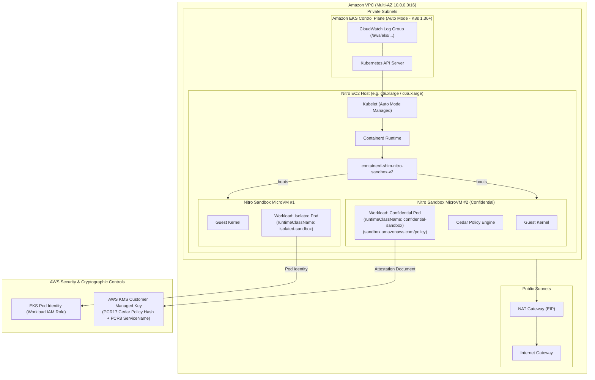

# Production-Ready AWS Nitro Sandboxes on Amazon EKS Auto Mode

[](https://github.com/Roslaan001/terraform-aws-eks-nitro-sandboxes/actions)
[](https://www.terraform.io/)
[](https://registry.terraform.io/providers/hashicorp/aws/latest)
[](LICENSE)

An enterprise-grade, verified Infrastructure-as-Code implementation provisioning **AWS Nitro Sandboxes** on **Amazon Elastic Kubernetes Service (Amazon EKS) with EKS Auto Mode** using HashiCorp Terraform.

---

## Table of Contents

- [1. Project Overview](#1-project-overview)
- [2. What AWS Nitro Sandboxes Are](#2-what-aws-nitro-sandboxes-are)
- [3. Architecture Diagram](#3-architecture-diagram)
- [4. Isolation Modes: Isolated vs Confidential](#4-isolation-modes-isolated-vs-confidential)
- [5. Cedar Policy & Attestation Workflow](#5-cedar-policy--attestation-workflow)
- [6. Prerequisites](#6-prerequisites)
- [7. AWS Region & Instance Requirements](#7-aws-region--instance-requirements)
- [8. Repository Structure](#8-repository-structure)
- [9. Deployment Instructions](#9-deployment-instructions)
- [10. Workload Deployment Guide](#10-workload-deployment-guide)
- [11. Verification Procedures](#11-verification-procedures)
- [12. Security Considerations & Threat Model](#12-security-considerations--threat-model)
- [13. Cost Considerations & Infrastructure Analysis](#13-cost-considerations--infrastructure-analysis)
- [14. Troubleshooting](#14-troubleshooting)
- [15. Cleanup Instructions](#15-cleanup-instructions)
- [16. License](#16-license)

---

## 1. Project Overview

Traditionally, security teams faced an uncompromising choice when deploying multi-tenant SaaS environments, agentic AI loops executing untrusted LLM-generated code, or regulated applications:
1. **Shared Kubernetes nodes**: Fast and dense, but a single Linux kernel vulnerability (`dirty pipe`, `overlayfs` exploits) allows a container breakout to compromise the host and neighboring workloads.
2. **Dedicated EC2 instances per tenant**: Strong hardware-level isolation, but cost-prohibitive, wasteful in idle compute reservations, and sluggish during scale-out.

Announced in November 2026 ([AWS What's New Announcement](https://aws.amazon.com/about-aws/whats-new/2026/11/nitro-sandboxes-eks-ecs-ec2/)), **AWS Nitro Sandboxes** resolve this trade-off by executing each pod inside an isolated lightweight virtual machine (microVM) directly powered by the AWS Nitro Hypervisor on a single shared EC2 instance at no extra compute charge beyond the underlying instance capacity.

This repository delivers:
- **Amazon EKS Auto Mode Infrastructure**: Clean Terraform implementation leveraging built-in `RuntimeClass` resources (`isolated-sandbox` and `confidential-sandbox`), least-privilege IAM, envelope KMS encryption with CloudWatch integration, and Kubernetes NetworkPolicies.
- **Hardware-Enforced Workload Isolation**: Ready-to-deploy isolated and confidential workloads featuring Cedar policy integration and KMS PCR17/PCR8 attestation gating.
- **Automated Validation Suite**: Native Terraform tests (`terraform test`), static validation, and operational verification scripts (`scripts/verify_sandbox.sh`).

---

## 2. What AWS Nitro Sandboxes Are

AWS Nitro Sandboxes leverage the **AWS Nitro System**—the core architecture powering modern EC2 instances that offloads hypervisor, networking (VPC), and storage (EBS) duties to dedicated hardware cards.

### Key Architectural Differences

```
Standard Containers (runc):
┌────────────────────────────────────────────────────────┐
│ Pod A (Tenant 1)              Pod B (Tenant 2 / AI)   │
│         ▲                              ▲               │
│         └──────────────┬───────────────┘               │
│             Shared Host Linux Kernel                   │  <-- Single kernel exploit breaks all pods!
│             Host EC2 Instance Hardware                 │
└────────────────────────────────────────────────────────┘

AWS Nitro Sandboxes:
┌────────────────────────────────────────────────────────┐
│ ┌─────────────────────────┐   ┌──────────────────────┐ │
│ │ Pod A (Tenant 1)        │   │ Pod B (Tenant 2 / AI)│ │
│ │ Per-Pod Guest Kernel    │   │ Per-Pod Guest Kernel │ │
│ │ Nitro MicroVM Boundary  │   │ Nitro MicroVM Boundary││
│ └───────────┬─────────────┘   └──────────┬───────────┘ │
│             │ (virtio)                   │ (virtio)    │
│ ┌───────────┴────────────────────────────┴───────────┐ │
│ │             AWS Nitro Hypervisor                   │ │  <-- Hardware-enforced isolation!
│ │             AWS Nitro System Hardware (SoC)        │ │
│ └────────────────────────────────────────────────────┘ │
└────────────────────────────────────────────────────────┘
```

- **Per-Pod Guest Kernel**: Every pod boots its own stripped-down Linux microVM kernel. System calls cannot reach the host kernel.
- **MicroVM Shim**: Managed via `containerd-shim-nitro-sandbox-v2` on the host, communicating with an in-guest agent via `virtio` devices.
- **Native Ecosystem**: Standard Kubernetes primitives (Amazon VPC CNI, EBS CSI driver, EKS Pod Identity, CloudWatch Container Insights) function seamlessly.
- **Built-in Auto Mode RuntimeClasses**:
  - `isolated-sandbox`: Hardware-isolated microVM boundary protecting the host and neighboring pods from container breakouts.
  - `confidential-sandbox`: Extends isolation with confidential computing, Cedar policy enforcement, encrypted overlay storage, and cryptographic attestation against AWS KMS before secrets release.

---

## 3. Architecture Diagram



---

## 4. Isolation Modes: Isolated vs Confidential

AWS Nitro Sandboxes provide two distinct isolation tiers on Amazon EKS:

| Dimension | `isolated-sandbox` | `confidential-sandbox` |
|---|---|---|
| **Primary Objective** | **Blast Radius Containment**: Prevent untrusted code from breaking out to the host or peer workloads. | **Zero-Trust Confidentiality**: Protect sensitive proprietary code, models, or data from host administrators and infrastructure. |
| **Trust Model** | Underlying EC2 host and node operators are trusted; running container code is untrusted. | Host operators, hypervisor admins, and neighboring pods are untrusted. Workload identity is cryptographically validated. |
| **Kernel Isolation** | Per-pod guest Linux kernel. | Per-pod guest Linux kernel. |
| **Memory Isolation** | Memory partitioned by the Nitro Hypervisor. | Memory partitioned by the Nitro Hypervisor; see the AWS Nitro Sandboxes documentation for confidential-mode memory protections. |
| **Policy Enforcement** | Standard Linux capabilities and container security context. | **Cedar Policy Engine**: Evaluated by the in-guest sandbox agent against the pod specification. |
| **Interactive Access (`exec` / `stdin`)** | Supported over vsock channel using standard Kubernetes RBAC. | Governed/restricted by the Cedar policy embedded at admission time. |
| **Cryptographic Attestation** | Not applicable. | **Mandatory**: Nitro Secure Module issues signed attestation containing PCR17 (Cedar policy hash) and PCR8 (`eks.amazonaws.com`). |
| **AWS KMS Secret Release** | Standard IAM role permissions. | Gated on `kms:RecipientAttestation:PCR17` and `kms:RecipientAttestation:PCR8:ServiceName`. |
| **Pod Container Sharing** | Containers inside the same pod share the same microVM. | Containers inside the same pod share the same microVM. |

---

## 5. Cedar Policy & Attestation Workflow

In **confidential mode**, workloads require a reproducible Cedar policy generated from the exact pod specification using `eks-nitro-sandbox-genpolicy`:

1. **Manifest Preparation**: The pod manifest specifies immutable container image digests (`image@sha256:...`), commands, environment variables, mounts, and security contexts.
2. **Policy Generation**:
   ```bash
   eks-nitro-sandbox-genpolicy --profile confidential pod-manifest.yaml
   ```
   This outputs:
   - Base64-encoded Cedar policy string.
   - Predicted **PCR17** measurement hash.
3. **Pod Annotation**: The base64 string is attached to the pod template:
   ```yaml
   metadata:
     annotations:
       sandbox.amazonaws.com/policy: "<BASE64_CEDAR_POLICY>"
   spec:
     runtimeClassName: confidential-sandbox
   ```
4. **KMS Policy Binding**: The KMS key policy restricts decryption strictly to requests presenting matching attestation:
   ```json
   "Condition": {
     "StringEquals": {
       "kms:RecipientAttestation:PCR17": "<PREDICTED_PCR17_HASH>",
       "kms:RecipientAttestation:PCR8:ServiceName": "eks.amazonaws.com"
     }
   }
   ```
5. **Regeneration Requirement**: If any aspect of the pod template changes (image digest, args, environment variables, mounts), the Cedar policy must be regenerated and the KMS PCR17 condition updated accordingly.

---

## 6. Prerequisites

- [Terraform](https://developer.hashicorp.com/terraform/install) `>= 1.6.0`
- [AWS CLI v2](https://docs.aws.amazon.com/cli/latest/userguide/install-cliv2.html) `>= 2.15.0`
- [kubectl](https://kubernetes.io/docs/tasks/tools/) `>= 1.30.0`
- Configured AWS credentials with permissions for VPC, IAM, KMS, and EKS.

---

## 7. AWS Region & Instance Requirements

- **Kubernetes Version**: Requires **Kubernetes 1.36 or later** for native AWS Nitro Sandboxes support on Amazon EKS.
- **Supported AWS Regions**: Regions with EKS Auto Mode support (e.g., `us-east-1`, `us-east-2`, `us-west-2`, `eu-west-1`, `eu-central-1`, `ap-northeast-1`).
- **Supported EC2 Instance Families**: Nitro-based instances supporting hardware virtualization and enclaves (e.g. `c6i`, `m6i`, `r6i`, `c6a`, `m6a`, `r6a`, `c7g`, `m7g`). EKS Auto Mode handles compatible node provisioning automatically.

---

## 8. Repository Structure

```text
.
├── vpc.tf                     # Multi-AZ VPC, private/public subnets, NAT Gateway, Flow Logs
├── iam.tf                     # EKS Auto Mode cluster, node, and Pod Identity IAM roles
├── kms.tf                     # Envelope encryption & PCR17/PCR8 attestation policy
├── eks.tf                     # EKS cluster with Auto Mode compute, storage, and networking
├── kubernetes.tf              # Namespace, network policies, isolated & confidential workloads
├── variables.tf               # Validated variables (Kubernetes 1.36+, sandbox_modes list)
├── outputs.tf                 # Cluster endpoints, KMS ARNs, verify commands
├── providers.tf               # AWS (>= 6.0) and Kubernetes (>= 2.35) providers
├── versions.tf                # Provider version constraints and lockfile
├── isolated.tfvars            # Preset: sandbox_modes = ["isolated"]
├── confidential.tfvars        # Preset: sandbox_modes = ["confidential"] with PCR17 hash
├── terraform.tfvars.example   # Dual-mode example: isolated + confidential
├── tests/
│   └── eks_validation.tftest.hcl  # Native Terraform unit and mock tests
├── scripts/
│   └── verify_sandbox.sh      # Operational verification script
├── Makefile                   # Automation targets (validate, test, plan)
├── .gitignore                 # Standard Terraform ignore rules
└── README.md                  # Comprehensive architectural guide
```

---

## 9. Deployment Instructions

### Step 1: Select Configuration Preset

```bash
# Option A: Deploy Isolated Sandboxes only
cp isolated.tfvars terraform.tfvars

# Option B: Deploy Confidential Sandboxes with Attestation
# cp confidential.tfvars terraform.tfvars

# Option C: Deploy Dual-Mode (Isolated + Confidential side-by-side)
# cp terraform.tfvars.example terraform.tfvars
```

### Step 2: Initialize and Validate Locally

```bash
# Initialize providers
terraform init -backend=false

# Validate syntax and rules
terraform fmt -check -recursive
terraform validate

# Run native unit tests
terraform test
```

### Step 3: Review Execution Plan

```bash
terraform plan -out=tfplan
```

### Step 4: Apply (Interactive Review)

```bash
terraform apply tfplan
```

### Step 5: Configure Kubectl Context

Run the explicit update-kubeconfig command:

```bash
aws eks update-kubeconfig --region us-east-1 --name nitro-sandbox-eks
```

---

## 10. Workload Deployment Guide

### Deploying an Isolated Workload

```yaml
apiVersion: apps/v1
kind: Deployment
metadata:
  name: isolated-workload
  namespace: nitro-sandboxes
spec:
  replicas: 2
  selector:
    matchLabels:
      app: isolated-workload
  template:
    metadata:
      labels:
        app: isolated-workload
    spec:
      runtimeClassName: isolated-sandbox  # Built-in Auto Mode RuntimeClass
      serviceAccountName: sandbox-workload-sa
      containers:
      - name: app
        image: public.ecr.aws/nginx/nginx-unprivileged:alpine
        securityContext:
          allowPrivilegeEscalation: false
          runAsNonRoot: true
          runAsUser: 101
          capabilities:
            drop: ["ALL"]
```

### Deploying a Confidential Workload

```yaml
apiVersion: apps/v1
kind: Deployment
metadata:
  name: confidential-workload
  namespace: nitro-sandboxes
spec:
  replicas: 2
  selector:
    matchLabels:
      app: confidential-workload
  template:
    metadata:
      labels:
        app: confidential-workload
      annotations:
        sandbox.amazonaws.com/policy: "<BASE64_CEDAR_POLICY>"
    spec:
      runtimeClassName: confidential-sandbox  # Built-in Auto Mode RuntimeClass
      serviceAccountName: sandbox-workload-sa
      containers:
      - name: app
        # Immutable digest is required for reproducible attestation
        image: public.ecr.aws/nginx/nginx-unprivileged@sha256:455dc8d655f41dd2944b58e727fdb3132e1d701765c92c474dcf7a6e74b9e27c
        securityContext:
          allowPrivilegeEscalation: false
          runAsNonRoot: true
          runAsUser: 101
          capabilities:
            drop: ["ALL"]
```

---

## 11. Verification Procedures

Execute the included operational verification script:

```bash
./scripts/verify_sandbox.sh nitro-sandboxes nitro-sandbox-eks us-east-1
```

### Verification Capabilities & Scope

1. **Static Validation**: Verifies HCL syntax, provider constraints, and resource references.
2. **Terraform Plan Validation**: Verifies plan composition against mock or live AWS accounts.
3. **Cluster Posture**: Validates that workloads reference built-in `isolated-sandbox` or `confidential-sandbox` RuntimeClasses and enforce restricted Pod Security Standards.
4. **Hardware Isolation Boundary**: MicroVM-based isolation is managed directly by the AWS Nitro Hypervisor, with CPU scheduling managed by the hypervisor across time-slices. Software verification commands (`ps aux`, `id`, `uname`) verify Kubernetes and guest container configuration, not hypervisor hardware virtualization. Cryptographic attestation documents cryptographically establish confidential workload identity.

---

## 12. Security Considerations & Threat Model

1. **Hardware MicroVM Boundary**: Nitro Sandboxes execute with a per-pod guest Linux kernel managed by the Nitro Hypervisor. In contrast to standard containers where a kernel exploit compromises the shared host kernel, microVM escapes are blocked by the hypervisor hardware boundary.
2. **Network Perimeter**: Worker nodes reside in private subnets. Kubernetes NetworkPolicies enforce a default-deny posture, whitelisting only essential DNS (UDP/TCP 53) and HTTPS (TCP 443) outbound traffic.
3. **Optional Network Isolation**: Applying `sandbox.amazonaws.com/network-isolated: "true"` boots the microVM without virtio-net interfaces, eliminating network egress. Note that this also restricts DNS resolution, NTP, IMDS, and Pod Identity credential renewal over the network.
4. **Least-Privilege IAM**:
   - Cluster role attaches modular Auto Mode policies (`AmazonEKSComputePolicy`, `AmazonEKSBlockStoragePolicyV2`, `AmazonEKSLoadBalancingPolicy`, `AmazonEKSNetworkingPolicy`).
   - Node role uses `AmazonEKSWorkerNodeMinimalPolicy` and `AmazonEC2ContainerRegistryPullOnly`.
   - Workload IAM role is assumed via EKS Pod Identity with scoped permissions.

---

## 13. Cost Considerations & Infrastructure Analysis

- **AWS Nitro Sandboxes Pricing**: There is **no additional charge** for AWS Nitro Sandboxes itself. You pay only for the underlying compute instances and EKS Auto Mode services.
- **Fixed Infrastructure Costs**:
  - Amazon EKS Cluster Management Fee: $0.10/hour (~$73.00/month).
  - Single NAT Gateway (us-east-1): ~$0.045/hour (~$32.85/month) plus data processing charges.
  - VPC Flow Logs & CloudWatch storage: Dependent on log volume.
- **Compute Efficiency**:
  - Running multi-tenant workloads in microVMs on shared instances avoids provisioning 1 full EC2 instance per tenant.
  - Actual cost savings depend on workload bin-packing density, vCPU/RAM allocation, and instance family selection. Meaningful cost comparisons must evaluate equivalent total vCPU and memory capacity.

---

## 14. Troubleshooting

### Issue 1: Pod stuck in `Pending` with `FailedScheduling`
- **Cause**: EKS Auto Mode is provisioning compute capacity or matching instance requirements.
- **Resolution**: Check Auto Mode node provisioning and verify subnet available IPs in the VPC.

### Issue 2: Confidential Pod Rejected
- **Cause**: The Cedar policy annotation `sandbox.amazonaws.com/policy` is missing, invalid, or does not match the deployed pod template.
- **Resolution**: Re-run `eks-nitro-sandbox-genpolicy` against the exact pod specification and update the pod annotation and KMS PCR17 condition.

### Issue 3: KMS Decrypt Access Denied
- **Cause**: The attestation document PCR17 hash does not match the KMS key policy condition or service principal is not `eks.amazonaws.com`.
- **Resolution**: Verify that the predicted PCR17 value in `confidential_expected_pcr17` matches the generated policy hash.

---

## 15. Cleanup Instructions

To destroy all deployed resources and prevent ongoing AWS charges:

```bash
# 1. Generate and review destroy plan
terraform plan -destroy -out=destroy.tfplan

# 2. Apply destruction
terraform apply destroy.tfplan

# 3. Clean local state files
make clean
```

---

## 16. License

This project is licensed under the Apache 2.0 License. See the [LICENSE](LICENSE) file for details.
